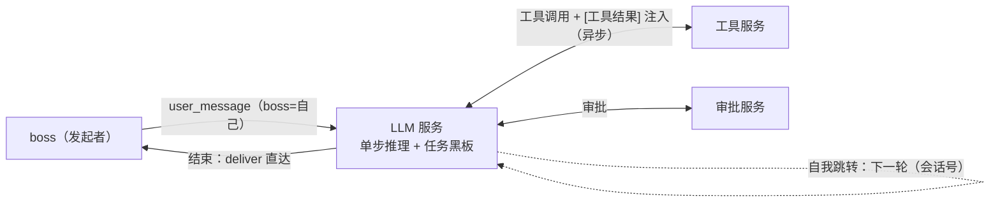
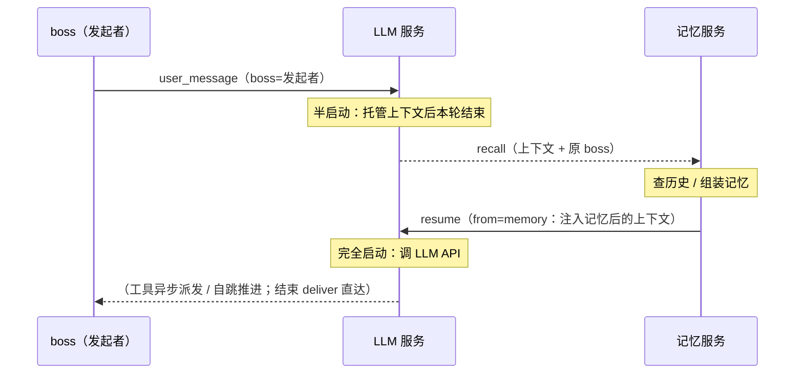

# 架构：为什么是「服务的互联网」

> **读者**：想理解这套设计为什么长成这样、而不是一个大单体的人 ｜ **读完能做**：判断一个改动是否在架构方向上、找到该改哪个服务 ｜ **最后校验**：2026-11-01

## 1. 一句话

SUMP 是「服务的互联网」：每个服务是独立进程、独立数据库、按地址可达的 WS 端点；**智能体循环不存在于任何服务内部**，而是 LLM 服务在网络上的自我跳转链。

## 2. 世界里只有两样基础设施

- **协议**（怎么说话）——见 [protocol.md](protocol.md)
- **设置中心**（谁在哪、有什么设置）——不是中央交换机，**不做流量中转**

除此之外没有任何特权服务：LLM 推理、记忆、图片、QQ / 门户接入、浏览器前端、工具、搜索、审批、智能家居……**全部是服务**，独立进程 / 独立库 / 可单独替换。

由此得到三条硬规则（正文见 [AGENTS.md](../../AGENTS.md)）：扩展不需要修改别人、唯一共享物是协议、能力可替换。

### 2.1 互联网类比

| 互联网 | SUMP |
| --- | --- |
| 网站 | 服务（独立进程 / 独立数据库 / 任意语言） |
| 网址 | 服务地址（`ws://host:port/...`） |
| 浏览器 + 网址栏 | LLM 服务发起的一次「访问」 |
| 网页间跳转 | 智能体循环的每一步 |
| 网民 | LLM 服务（决定下一个访问哪里） |

### 2.2 设置中心像 DNS，但不是交换机

- **注册**：服务自报位置（地址）、可设置项、功能简介、接受什么输入、有什么输出。
- **全局信息分发**：新服务注册时中心向所有服务推送**全量**名册（`roster` 事件）；服务也可随时 `jump` 取一次（推送丢失 / 服务重启后的自愈手段）。
- **设置与调度**：中心下发设置、改变各服务的行为——**业务调用不经中心中转**。
- **离线判定**：服务在名片里声明心跳间隔，中心超过 2× 未见即摘除并广播；退出前的 `bye` 立即摘除；心跳晚到可从墓碑复归。
- **错误上报**：服务经既有连接 `report`，中心记日志并交给 `OnReport` 挂点；上报方自己退避防刷（1s 起翻倍、封顶 30s），中心视为永远在线、不排队不回补。

## 3. 服务清单

| 服务 | 语言 | 一句话职责 |
| --- | --- | --- |
| settings-center | Go | 维护「服务名 → 名片」注册表；注册返回名册、新注册广播名册；保管设置并提供存取动作 |
| reasoner | Go | 单步推理器：任务入口经 memory 托管、收到 resume 才调 LLM；工具异步派发（即时回执 → 结果注入 → 唤醒），收尾门禁保护，结果 deliver 直达 boss |
| memory | Go | 会话消息的唯一保管者；recall 取最近历史 + 长期记忆组装为记忆块后 resume 回调用方；remember 写入 / forget 软删；任务与经验网也在这里 |
| images | Go | save（URL/base64 落盘）返回 id；fetch（id → base64） |
| files | Go | save / fetch / read（文本截断、xlsx 转 TSV、docx/pptx 提取正文）/ write（单元格级编辑）/ edit_word / edit_ppt |
| shell | Go | 受理即回执的命令执行（无队列，只有防爆熔断；超时终止 + 输出截断）；审批接缝（未接入 = 一律未通过）；结果由 `report_result` 补报 |
| approval | Go | 终端命令审批：PowerShell AST / POSIX 保守词法器 + 不可变规则快照 + 执行摘要绑定 + fail-closed；第二层用户裁决 |
| timer | Go | 计时器：受理「N 毫秒后唤醒我」（即时回执）→ 到点把 `report_result` 跳回调用方；按 boss 分组推倒计时 |
| batch | Go | 批处理：一次声明 N 项工作 + 并发度 + 唤醒时机；暂停可恢复、停止是终态；目标动作须显式声明 `Batchable` |
| mcp | Go | 双向协议翻译：显式映射导出获准的原生能力、导入外部 MCP 工具；只登记自身，不自动传播下属能力 |
| qq | Go | 把私聊（仅主人）与群聊消息打成 `user_message`（**带来源标注**：谁说的 / 群还是私聊 / 多少人可见 / 是否主人 / 是否被 @）发给 reasoner；群聊策略 `group.mode`（观察 / 仅@ / 判断）；不该开推理的消息自己写进记忆；实现 deliver 回发（私聊与群聊） |
| frontend | TS | 用户交互门户（与 qq 同类）＋ 设置面板：提供 `deliver`（推给浏览器）、`report_result`（终端命令的结果）；自己跳 `user_message`（转给 reasoner）、`files.save` / `images.save`（用户上传的附件）、`shell.run`（终端命令，仍走审批）；浏览器 HTTP JSON + SSE；单用户 + Host/Origin 栅栏 |
| embedding | Python | 文本 → 向量（onnxruntime + tokenizers，CLS pooling + L2 归一）；动作 `embed`；fake 后端供测试与 CI |

两个 Go **库**（不是服务）：`protocol/`（协议与载荷类型）、`service/`（服务骨架：注册 / 心跳 / 名册 / 重连 / 告别 / 设置接收）。根 `tests/` 是跨服务真进程端到端，不属于任何服务。

端口一览见 [../quickstart.md](../quickstart.md)。

## 4. 一次对话怎么流动

```text
门户/QQ ──user_message(boss=自己)──▶ reasoner
reasoner ──recall──▶ memory            （上下文托管出去）
memory ──resume(from=memory)──▶ reasoner   （只有收到它才真正调模型）
reasoner ──jump──▶ 工具服务（shell / files / images / timer / batch / …）
工具服务 ──report_result──▶ 调用方       （长耗时的都走异步补报）
reasoner ──deliver──▶ boss             （终点直达，不沿链逆向回传）
```

三条容易记错的点：

- **boss 不可丢**：入口服务必须把 boss 设成自己，否则回答照样生成但**回不来**（reasoner 只按 boss 交付）。
- **记忆是真相**：`progress` 只是「别等最后才看见」，丢一条不影响历史。
- **发出即完**：一步 = 收到 → 处理 → 发出下一跳 → 结束；`wait` 是唯一的阻塞点。

运行时语义（工具异步、会话记录、任务、经验网、复盘）见 [agent-loop.md](agent-loop.md)。



### 4.1 记忆往返：完全启动

LLM 服务不自己持有记忆——**每次调用 LLM API 之前，都要先把任务上下文托管给记忆服务**：

- 收到任务入口（`user_message`）时只做「半启动」：把上下文（含原 boss）以 `recall` 交给记忆服务，本轮结束（发出即完）；任务内的后续轮次由黑板延续，不再重复经记忆。
- 记忆服务查询会话历史、组装记忆——**注入什么记忆、上下文最终长什么样，全由记忆服务决定**（LLM 服务只负责把组装结果交给 LLM API）。
- 记忆服务把组装后的上下文以 `resume` 发回；LLM 服务**只在收到 `from=memory` 的 `resume` 时才「完全启动」——这是调用 LLM API 的唯一入口**（其他来源一律拒绝）。
- 信封 `boss`：记忆为 llm 工作（请求与回复的 boss 均为 llm）；原任务 boss 随上下文托管、原样带回，交付时仍直达原 boss。



### 4.2 图片链路（qq → images → llm）

- qq 收到图片：把 URL 交给 images 保存（`save` → `{id}`），`user_message` 携带图片 id。
- LLM 在「完全启动」后、调 API 前：对**最近一条带图消息**的 id 逐个 `images.fetch_full`（原图 base64），组装为 OpenAI 多模态内容内联；更早的图片转文本占位 `[图片]`。模型自己查看图片时用的是 `images.fetch`（缩略图 / 矩形窗口），拿不到原图。
- images 独立库（SQLite 元数据 + 文件目录），单图上限 32MiB（对齐 DeepSeek 图片限制）。

### 4.3 文件链路（qq → files → llm 凭 id 自取）

- qq 收到文件：交给 files `save`，`user_message` 携带文件 id，并在文本里附加占位 `[文件: 名, id=...]`——占位必须带 id：文件不自动内联，是模型凭 id 自取。
- `read` 在 `provides` 里声明 `tool: true`，经名册自动成为 LLM 工具（`files__read`），**reasoner 零改动**（同 `remember` 先例）：文本类返回截断文本（`read_max_chars` 默认 4000，`truncated` 显式标记「没给全」）；`.xlsx` 转 TSV、`.docx` 提取正文；二进制 / 旧版 Office 明确拒绝。
- `write` 单元格级编辑、`edit_word` / `edit_ppt` 纯文本替换，都就地修改库内**唯一权威副本**。
- **就地覆盖的取舍（明写在案）**：原字节不留（无副本、无版本、无回收站）——改文件是显式动作，留副本等于把 files 变成版本库，那是另一个服务的边界。代价说清楚：模型一次调用就能改掉主人的原文件且**不可回退**；要原件请在改动前 `fetch` 一份。
- **解压封顶（压缩炸弹防线）**：`.xlsx` / `.docx` 都是 zip，文件本体受 `max_mb` 管，但解压后的大小不受它管。两道防线：zip 目录实体大小预检 + 读取时 `io.LimitReader` 兜住「头部撒谎」的包；xlsx 侧把同一上限传给 excelize 的 `UnzipSizeLimit`。上限 256MiB。
- files 独立库（SQLite 元数据 + 文件目录），单文件上限默认 100MiB（`-max-mb` 可调）。

### 4.4 通信与性能约定

- 服务间 WS **不做纯长连接**：默认短连接、空闲即断；访问频繁则连接保留时长上涨，冷下来回落——随实际访问频率自适应增减（阈值与公式待定）。每个服务也可自定义自己的默认连接时长，作为自己的设置项下发——**这部分尚未实现**。
- **流式直通**：LLM token 流从 reasoner 一路透传到 QQ / 浏览器，中间不攒批——**尚未实现**：当前 `ChatRequest` 没有 stream 字段，LLM 返回的是完整响应，SSE 只推 `deliver` / `progress` 这类整块事件。
- **并行跳转**：一轮内多个跳转并行发出（goroutine），汇合后继续推理。

## 5. 数据归属

每个服务只读写**自己的**库与目录；跨服务的一切都走消息。派生数据（缓存 / 向量 / 索引）必须可丢弃、可重建——**权威数据只有一份**。

### 5.1 会话私有 vs 用户共享

记忆服务持有**两个库文件**，这条分界不是目录习惯，是隐私边界：

| 库 | 谁看得见 | 内容 |
| --- | --- | --- |
| `data/memory.db`（会话库） | **只有当事会话** | `conversations`、`messages`（对话与轨迹）、`tasks` |
| `data/experience.db`（共享库） | 所有会话（都是提炼物） | `memories`（偏好 / 事实）、经验网三表、`shared_sessions` / `shared_tasks`（会话目录） |

- 共享库里**没有承载原文的字段**：没有 `messages`、没有工具输出、没有文件字节。泄露在形状上不可能发生，不靠过滤器。
- 会话目录每条只有「在做什么 / 做到哪了 / 用过哪些能力」，每个会话最多留最近 3 条；任务可标 `private`（只写经验、不进目录）。
- 模型**没有任何动作**能读别的会话的记录（`history` / `task_*` 都不在 `provides` 的 `tool: true` 里）。
- **人**的界面（门户）能不能看别的入口的会话，是门户侧的事（见 [agent-loop.md](agent-loop.md) §6.3）；模型侧没有任何这类路径。
- 权威数据仍然只有一份：搬到共享库之后，旧表改名 `legacy_*` 留着字节，不再被读。

| 服务 | 落点 | 内容 |
| --- | --- | --- |
| memory | `data/memory.db` | 会话库：`conversations`、`messages`、`tasks` |
| memory | `data/experience.db` | 共享库：`memories`、经验网三表、`shared_sessions`、`shared_tasks` |
| images | `data/images.db` + `data/images/` | 元数据 + 图片文件 |
| files | `data/files.db` + `data/files/` | 元数据（含 `filename`）+ 文件 |
| settings-center | `data/settings.json` | 设置覆盖值（预设值由各服务声明，不落盘） |
| batch | `data/batch.db` | 任务与工作项（重启后能给出明确归宿） |
| 各服务 | `data/<名>-secret.json` | 秘密项的明文文件（目录 0700、文件 0600、原子替换） |

`data/` 不入库；删掉它等于清空记忆、文件与设置。

## 6. 与 v1 的关系

- 本仓库是 **v2 主线**，承载当前全部开发。
- **v1 已停止开发**：单进程 Python 单体，进程内共享状态 + 并发竞态严重；源码与版本历史归档在 [sump-v1](https://github.com/QAQ-awa-QAQ/sump-v1)。
- 重构的核心取舍：用「服务隔离 + 网络通信 + 无驻留循环」从根上消除共享状态问题——代价是每次跨服务交互都要过网络与序列化。
- 走过哪些弯路、当时怎么取舍的，见 [../archive/v1-to-v2.md](../archive/v1-to-v2.md)。

## 7. 这个架构刻意不做的事

- **不做中央调度**：中心只管名册与设置，不转发业务调用（否则它就是单点与新特权服务）。
- **不做进程内共享**：需要共享的东西要么进协议，要么归某一个服务所有。
- **不做"跨会话共享对话"**：跨会话共享的只有提炼物（偏好 / 一句话经验 / 会话摘要），原文永远留在当事会话里。
- **不做万能插件宿主**：一个能力 = 一个服务，语言自由，可被同名同语义的实现替换。
- **不提前做生态层**：认证、市场、多租户属于后续阶段，见 [roadmap.md](roadmap.md)。
